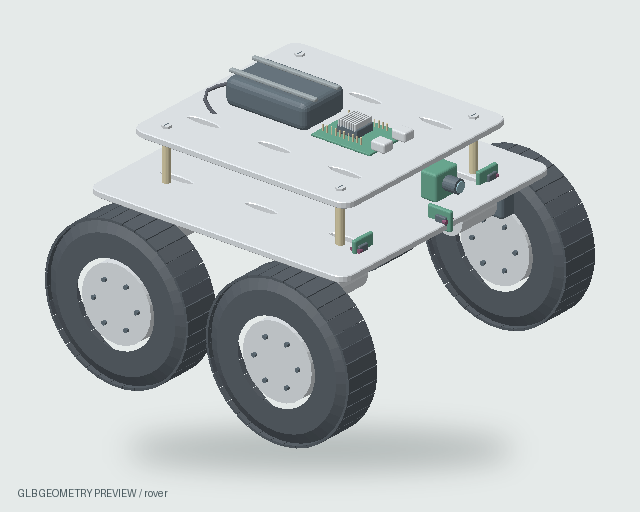
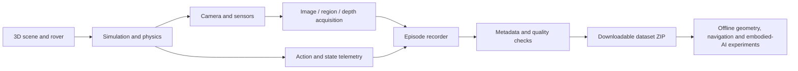

<div align="center">

# DYNORA

### A browser-based robotics simulation and dataset studio for embodied AI research

**Design environments · Simulate robotic motion · Capture synchronized observations · Export reproducible experiments**

   

**[Get started](#-quick-start)** · **[Capabilities](#-what-dynora-does)** · **[Dataset pipeline](#-dataset-recording-and-exports)** · **[Architecture](#-architecture)** · **[Research scope](#-research-motivation-and-scope)**



<sub>Example rover mesh included in the simulator</sub>

</div>

---

## Overview

**DYNORA** is a local-first 3D robotics research environment for developing, testing and collecting data from virtual robotic experiments. It combines editable indoor scenes, selectable four-wheeled rovers, simulated sensors, interactive control, contact physics, image/depth annotations and structured recording in one browser-accessible workflow.

Its purpose is to make **episode-based experiments** practical without requiring an expensive physical robot for every iteration. By collecting visual observations together with movement, sensor and simulation metadata, DYNORA provides a starting point for studying perception, navigation, geometry and the relationship between **physical motion and visual change**.

> **Current release:** `v15.8.4` — saved image regions can be individually enabled or disabled for **live depth updates and synchronized outline snapshots**. Multiple enabled regions can update together. Editing focus is independent from capture selection.

### At a glance

| Area | Included capabilities |
| :--- | :--- |
| **3D environments** | Apartment / corridor, canteen / cafeteria and configurable obstacle track; scene placement and visual editing |
| **Robot simulation** | Five selectable 4WD rover profiles, manual driving, differential/skid-steer behaviour and configurable dynamics |
| **Physics** | Rapier contact simulation, configurable friction/terrain, contact inspection and a separate physics test lab |
| **Sensors** | Camera observations, simulated time-of-flight sensors, encoders, IMU-like telemetry and optional labelled depth/instance outputs |
| **Navigation** | Observed occupancy mapping, worker-based A* planning, goal selection and optional local Python policy control |
| **Depth and outlines** | Object/part, rectangle, polygon and point selections; live sampled depths, patch grids and selection-based snap boundaries |
| **Datasets** | Paired frame records, selected-depth results, sensor/action data, calibration, metadata and verified ZIP exports |
| **Research utilities** | Calibration, simulation-vs-hardware comparison, dataset quality checks, replay and dataset splitting |
| **Scene assets** | Furniture, material textures, robot geometry and animated human models with attribution documents |

## 🚀 Quick start

DYNORA comes with a **prebuilt offline-capable web app** in `dist/`. You can run the included version using Python, without first installing Node.js or rebuilding the project.

### Option A — Run the included app (easiest)

1. Download this repository as a ZIP (GitHub → **Code → Download ZIP**) and extract it, or clone it.
2. Install **Python 3** if you do not already have it.
3. From the project directory, run:

   **Windows (PowerShell)**
   ```powershell
   py server.py
   ```

   **macOS / Linux**
   ```bash
   python3 server.py
   ```

4. The server opens `http://127.0.0.1:8774/` in your browser. Use a modern desktop version of Chrome or Edge with WebGL enabled.

Windows users can also double-click **`start-windows.bat`** (opens port `8774`) or **`START_DYNORA.bat`** (serves `dist/` on port `8000`; open `http://localhost:8000`). On macOS/Linux, `sh start-mac-linux.sh` runs the Python server.

**Local demo sign-in:** `admin` / `robot123`. Credentials are stored locally in the browser and this is **not a production authentication system**. Do not treat it as access protection for an internet-facing deployment.

### Option B — Run the development version

Use **Node.js 22** (other versions may work but are not specifically verified by the bundled documentation):

```bash
npm ci
npm run dev
```

Open the URL displayed by Vite, usually `http://127.0.0.1:5173/`.

```bash
npm test            # Run the JavaScript test suite
npm run build       # Generate a fresh production dist/
npm run preview     # Preview the production build
```

**Important for GitHub clones:** `dist/` is intentionally included in the repository. It holds the working prebuilt app **and** the original packaged assets needed by the `predev`, `pretest` and `prebuild` asset-restoration hooks. Keep `dist/` available when running from source. The generated `public/` copies and `node_modules/` are ignored by Git.

## 🧭 What DYNORA does

### 1. Create environments and place agents

Work with indoor layouts, furniture and room objects, adjustable scene elements, gates and obstacle tracks. Spawn and configure a rover, inspect the 3D environment, and switch between top, orbit, follow, chase and robot-camera views. The bundle also includes textured human characters and a human-motion scene for walking, sitting and standing transitions.

### 2. Simulate movement, contacts and sensing

Control rover motion directly, test manoeuvres in an isolated lab, and inspect sensor feedback or collision/contact data. The simulator exposes settings for motor response, mass, wheel/terrain interaction, surface grip and related effects. Configurations are **simulation approximations**, not substitutes for calibration on a real robot.

### 3. Navigate with a baseline planner or an external controller

The Rovers tools include a local occupancy-map workflow using simulated observations and a worker-based A* planner. A separate HTTP bridge lets you run your own Python policy locally. For example:

```python
def policy(observation):
    # Example action — replace with your own control strategy.
    return {"left": 0.25, "right": 0.25, "brake": False, "ttl_ms": 250}
```

Start the bridge with:

```bash
python tools/controller_server.py --controller examples/reactive_controller.py
```

Connect the displayed local endpoint and token in **Rovers → Python / model controller**. A safe stop baseline is available in `examples/stop_controller.py`. The bridge uses a short command lifetime and braking watchdog; it does **not** include a pretrained policy or guarantee collision-free navigation.

### 4. Select image regions and track their visible boundaries

In **Depth → Choose regions · live + snap**, create and manage regions on the camera image. Each saved region has its own **Use** checkbox:

- Enable one or several regions to display their **green outlines** and acquire their live depth/patch values together.
- Disable a region to retain it for later without including it in new snapshots.
- Use **Region to edit** to change the currently edited region *without* silently changing which regions are enabled.
- Use **Check all**, **Uncheck all** or **Only edited region** to change the capture selection quickly.
- Take a **Snap** to freeze the enabled region set alongside its image, camera and scene state; the selected-boundary mode avoids automatically substituting unrelated object outlines.

For sampling and outline limitations, read **[v15.8.4 selection notes](docs/UPDATE_V15_8_4.md)** and **[v15.7 boundary notes](docs/UPDATE_V15_7.md)**.

## 📦 Dataset recording and exports

DYNORA records observations as experimental episodes. The workflow is designed to preserve the relationship between **what the robot saw**, **what its sensors and simulated dynamics reported**, and **what command it executed**.



**Typical capture workflow:** select an environment and rover → enable the image regions you want → choose recording settings → press **Record** → move or navigate the rover → press **Stop & export** → use the verified **Download ZIP** link.

Depending on enabled options, the exported dataset contains:

| Data | Description |
| :--- | :--- |
| RGB frames | Recorded camera images with frame identity and acquisition context |
| Boundary snaps | Images of selected outlines paired with captured RGB frames |
| Depth measurements | Saved region and/or patch depth outputs, with camera/frame associations |
| Sensor telemetry | Simulated ToF, wheel encoder, motion/IMU-style and related measurements |
| Actions | Steering / motor commands and their timing context |
| Metadata | Run, frame and region identifiers, capture times, calibration and configuration |
| Quality evidence | Manifest and integrity information, with dataset quality checks |
| Optional labels | Configurable metric-depth and instance-mask `.npy` ground-truth outputs |

The newer **lean recording** pipeline omits optional full scene/CAD backups and some replay/event artifacts to keep ordinary experiment exports focused on sensor and observation data. The exact files depend on recording configuration and the run; do not assume every optional output is present in every ZIP.

See [dataset recording notes](docs/UPDATE_V15_4.md), [image-boundary capture](docs/UPDATE_V15_7.md), and [rover/research data formats](docs/UPDATE_V15.md).

## 🏗️ Architecture

DYNORA is primarily a **JavaScript browser application**. A small local Python server serves the prebuilt assets, while an optional Python bridge connects control policies.

| Component | Responsibility |
| :--- | :--- |
| **Three.js** | 3D rendering, camera views, models and interactive environments |
| **Rapier 3D** | Rigid-body contacts and physics behaviour |
| **Vite** | Development server and multi-page production builds |
| **Web Workers** | Selected navigation, physics/evaluation computations |
| **Browser capture + JSZip** | Local frame/sensor recording and export of dataset archives |
| **Python standard library** | Local prebuilt-app serving and optional controller endpoint |

```text
DYNORA/
├── index.html                # Main simulator entry point
├── research.html             # Research and dataset utilities
├── test-lab.html             # Physics and experiment workbench
├── verification.html         # Numerical verification tools
├── showroom.html             # Scene/model showroom
├── motion.html               # Human motion lab
├── src/                      # Main simulator, scene, physics, depth and UI sources
├── assets/                   # Robot mesh/part assets
├── dist/                     # Prebuilt runnable app + bundled visual assets
├── tests/                    # JavaScript and Python tests
├── tools/                    # Local controller and developer utilities
├── examples/                 # Minimal example control policies
├── docs/                     # Guides, validation logs, and version history
├── server.py                 # Local Python web server
├── START_DYNORA.bat          # Windows prebuilt-server shortcut (port 8000)
├── package.json              # Node/Vite commands and dependencies
└── LICENSE                   # MIT code license
```

## 🔬 Research motivation and scope

A research direction enabled by these experiments is to compare **changes in visible object boundaries** with robot movement, camera geometry and known simulation measurements. This can support investigations into perspective, apparent area/perimeter, motion cues, relative depth and embodied perception. DYNORA's synchronized frames, selected outlines and sensor/pose context provide inputs for those studies.

**Important distinction:** image-contour area/perimeter alone does **not** uniquely determine metric depth. Recovering depth or 3D structure requires additional assumptions or evidence, such as camera calibration, known object dimensions, multiple views, motion constraints or ground truth. **Fourier contour reconstruction and a learned depth-estimation model are research directions, not claimed built-in features of this v15.8.4 ZIP.** This repository should not be cited as validating those methods unless they are implemented and evaluated separately.

The environment is useful for prototyping and controlled comparisons, but it is **not** a high-fidelity digital twin or a guarantee of real-world robot behaviour. Sensor models, wheel slip, people, materials, contact approximations and simulation-to-reality transfer require independent evaluation.

## 🧪 Validation and reproducibility

The repository includes test files and recorded validation artifacts under `tests/` and `docs/`. For local development:

```bash
npm ci
npm test
npm run build
python -m unittest discover -s tests -p 'test_*.py'
```

Historical validation files document their specific software versions, inputs and test environments; they do not imply that every browser/GPU combination or deployment has been verified. See **[latest update notes](docs/UPDATE_V15_8_4.md)** and **[historical validation summary](docs/VALIDATION_V15.md)**.

## 🔐 Privacy and deployment notes

The included app can run on your machine without a cloud account, and browser recording/ZIP preparation is local by default. The bundled sign-in is a **local demonstration mechanism**. Browser-stored data, local endpoints and controller tokens should not be treated as a secure multi-user authentication system. Review security, CORS, network exposure and asset rights before using a public hosting service or external data.

For a personal GitHub Pages or static hosting demo, build the Vite app and publish the generated static files. The repository also includes a `wrangler.toml` starting point for a **Cloudflare Pages project you control**; the presence of that configuration does not mean a site is already deployed.

## 📚 Documentation

| Reference | Contents |
| :--- | :--- |
| [Current region-selection update](docs/UPDATE_V15_8_4.md) | Multi-region Use checkboxes and frozen snap selection |
| [Selected boundary snapshots](docs/UPDATE_V15_7.md) | Outlines, snap pairing and clipping |
| [Depth recording](docs/UPDATE_V15_4.md) | Frame-level image/depth linkage |
| [Rover and research tools](docs/UPDATE_V15.md) | Rover models, mapping, Python bridge and dataset formats |
| [Physics test lab](docs/TEST_LAB_V11.md) | Controlled manual and scripted experiments |
| [Visual-asset credits](dist/visual/ASSET_CREDITS.md) | Original models and third-party materials |
| [Human-asset credits](dist/visual/humans/CREDITS.md) | Character-model source and licence information |

Older documents may describe earlier releases or historical project naming; the repository title and current application branding are **DYNORA**. For instructions to publish your own repository, see **[GITHUB_SETUP.md](GITHUB_SETUP.md)**.

## 🤝 Contributing

Issues, reproducible bug reports, dataset-format improvements, sensor models, evaluation benchmarks and research-friendly documentation are welcome. Read [CONTRIBUTING.md](CONTRIBUTING.md) before proposing a change. Please include enough information to reproduce simulations and do not submit proprietary or unlicensed assets.

## 📄 License and attribution

The project's original source code is distributed under the **[MIT License](LICENSE)**. Bundled dependencies, character models, textures, HDRI files and other third-party assets may have **separate licence and attribution terms**. Check [visual credits](dist/visual/ASSET_CREDITS.md), [human credits](dist/visual/humans/CREDITS.md), and the notices in `docs/` before redistributing assets.

---

<div align="center">

**DYNORA — from simulated motion to structured visual experience.**

*An evolving research platform; observations and hypotheses should always be tested against measured data.*

</div>
# DYNORA

